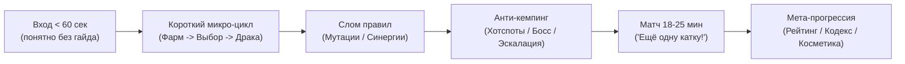
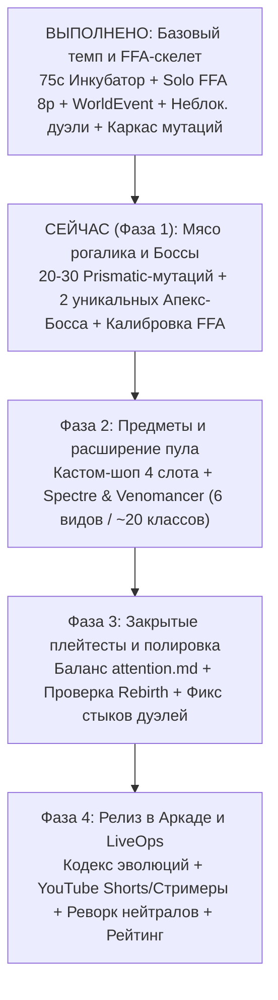

# Стратегическая аналитика проекта Evo («Adapt. Win.»)

> [!NOTE]
> **Обновлено 2026-11-26 (Ревизия v2):** учтены свежие изменения из `CHANGELOG.md` и кодовой базы — переход на **Solo FFA (8 игроков)**, сжатие Инкубатора до `75с`, запуск центральных мировых ивентов (`WorldEventManager`), нейтральные безопасные фонтаны с телепортом (`FountainManager`), отказ от паузы мира на дуэлях (`DuelManager`) и включение пайплайна драфта мутаций (`evolution_mutations.ts`).

---

## 1. Честный вердикт (Ревизия v2): на каком этапе проект сейчас?

**Короткий ответ:** За последний спринт проект сделал **качественный скачок** — ты закрыл 4 из 5 системных проблем геймплейного скелета, которые тормозили режим. Сейчас Evo — это уже **цельный, быстрый Solo FFA PvPvE-броулер с рабочим темпом, точками притяжения и готовым каркасом мутаций**.

До состояния **«по-настоящему цепляющей публичной Альфы»** отделяют ровно **3 содержательных шага**:
1. Наполнить уже работающий каркас мутаций **реальными Prismatic/Апекс-мутациями** (вместо текущих 10 микро-статов `+1/+5`).
2. Заменить дефолтного Слардара и добавить **2-го уникального Апекс-Босса** (сделать боссов настоящим лицом экосистемы).
3. Подключить твои **кастомные предметы (4 слота)** + подкрутить 3 балансные шероховатости Solo FFA (цель по очкам `2500`, стык дуэлей и Метеорита, риск Rebirth).

### Что уже сделано на уровне выше рынка (актуальные козыри)
1. **Взрослая архитектура и пайплайны:** Модульный TypeScript (`EventBus`, `DamageFilterManager`, `LazyPrecacheManager`), автогенераторы из JSON (`generate_branches.py`, `generate_neutrals.py`, `generate_localization.py`), нативный Panorama UI и автопроверки.
2. **Живой ритм матча (`75с` Инкубатор + `WorldEventManager`):** Вместо 5 минут тишины теперь уже на `1:15` открывается Поверхность и выходит Апекс-Босс, на `1:30` спавнятся активные руны, а на `1:35` (и каждые `150с`) в центре падает **Источник Биомассы** (KOTH-захват с общим вижном, пингами, `+40` очками, золотом, XP и хилом). Это полностью решает проблему «сидения по углам».
3. **Низкий порог старта — Solo FFA (до 8 игроков) + `FountainManager`:** Переход с жёсткого `3v3v3v3` на 8-игроковой Solo FFA с 2 нейтральными неуязвимыми базами и кнопкой **Teleport** над миникартой снял главную угрозу «мёртвых лобби» и зависимости от тиммейтов.
4. **Неблокирующие дуэли и рабочий каркас Мутаций:** Мир больше не замирает на время 1v1-дуэлей, а на T2/T3/T4 уже работает полноценный UI-драфт мутаций `1 из 3` с 2 рероллами за матч и иконками в баффах.
5. **Глубокий пул веток:** 4 вида (Bristleback, Morphling, Nyx, Slark) = **13 полноценных финальных архетипов** + готовые дизайн-доки для Spectre и Venomancer (`morph_data/`).

### Статус 5 узких горлышек + новые находки после рефакторинга

| # | Проблема | Статус | Актуальное состояние и что осталось докрутить |
|---|---|---|---|
| **1** | Жёсткий формат `3v3v3v3` (12 игроков) | ✅ **Решено** | Переведено на **Solo FFA (8 игроков)** + 2 нейтральных фонтана с телепортом (`FountainManager`). *Мелочь на проверку:* не дать абузить край неуязвимого фонтана в драке (сайленс/дизарм под аурой или комбат-лок). |
| **2** | 5 минут Инкубатора без PvP | ✅ **Решено** | Сжато до `75с` + добавлен центральный KOTH-ивент `WorldEventManager` каждые `150с`. |
| **3** | Пауза всего мира на дуэлях | ✅ **Решено (с нюансом)** | `applyWorldPause` удалён. **Новый нюанс:** при 8 игроках 4 пары подряд занимают до `120с` каждые `180с`, и игрока может выдернуть в дуэль прямо с захвата Метеорита ради `+15` очков (против `+40` за Метеорит). Нужно развести таймеры дуэлей и ивента + поднять ценность дуэли. |
| **4** | «Рельсы» после T2 / глубина адаптации | 🟡 **Каркас готов** | Драфт мутаций на T2/T3/T4 с рероллами уже в игре, но внутри лежат **10 микро-статов** (`+1` стата, `+5` урона). Как только заменишь их на 20–30 Prismatic-мутаций + свяжешь с биомами — проблема будет закрыта полностью (а нелинейные ветки T3/T4 спокойно ждут пост-альфу). |
| **5** | Риск «наказания перерождением» (Rebirth → Lv.1) | ⏳ **На подумать** | В быстром Solo FFA с 75с Инкубатором и частыми драками за Метеорит риск стать уязвимым на T2/T3 Lv.1 даже выше. Держим на контроле для первых плейтестов. |
| **6** | **[Новое]** `TARGET_TEAM_SCORE = 2500` в Solo FFA | ⚠️ **Требует калибровки** | Планка `2500` очков задавалась для команд из **3 человек**. В Solo FFA (1 человек = 1 команда) набор очков идёт в ~2.5–3× медленнее — матч без лимита времени рискует растянуться на 35–50 минут. Ориентир для Solo FFA: `~900–1200` очков (или динамическая планка от размера команды). |
| **7** | **[Новое]** Босс-арена отключена в Solo FFA + «скучный Слардар» | ⚠️ **В работу** | Сейчас единственный босс визуально ощущается как обычный Слардар, а Босс-арена выключена в FFA (`hasMultiPlayerTeams()`). Нужны 2 реально уникальных Апекс-Босса + FFA-ивент «Охота на Апекса» прямо на карте. |

---

## 2. Как развивались и на чём выжили топ-кастомки (бенчмарк 2019–2026)

Важный контекст рынка: в **октябре 2026 года Valve провела крупнейшую зачистку ботоферм в Аркаде** (убрав ~200–300к фейковых ботов, искусственно забивавших топ витрины). Сейчас **лучший момент за последние 3 года**, чтобы выходить с качественной оригинальной кастомкой: витрина снова живая, а игроки устали от P2W-помоек.

### Сравнительная таблица эталонных игр и уроки для Evo

| Проект | Формат и темп | Главный двигатель ретеншна | Как начинал и эволюционировал | Главная ошибка / риск |
|---|---|---|---|---|
| **Dota 1x6** *(Xeno)* | 6 чел. FFA, ~18–25 мин | **Глубина билдов (28 талантов на героя)** + 100% личная агентность (нет руинеров-тиммейтов) + рейтинг | Стартовал с **маленького пула героев**, добавлял по 1–2 в патч, полировал сферы, дуэли и таланты; вырос через YouTube/стримы и честную подписку | Высокий порог входа для казуалов; зависимость от постоянного баланса каждого таланта |
| **Custom Hero Chaos / Clash** | 8 чел. FFA, ~25–35 мин | **Дофамин «сломанной синергии»** (RNG-драфт скиллов + контроль рандома через рероллы) + ставки на дуэли | Начал как чистый драфт скиллов → добавил волны, мини-боссов, ставки, нейтральные абилки, турнирный рейтинг | Информационная перегрузка UI, поломки магазина/модификаторов после крупных патчей Valve |
| **Overthrow 3.0** | 2v2v2v2 / 3v3v3 / FFA, ~12–18 мин | **Мгновенный экшен** (вход за 5 секунд) + **точка притяжения (Midas Throne)** и дроп сундуков | Вырос из простого шаблона Valve → добавил перманентные апгрейды (сферы), сохранение билдов, разные форматы карт | Агрессивная монетизация / P2W → баны Valve, вылеты из Workshop и потеря доверия |
| **Angel Arena (Reborn / Black Star)** | Команды, PvPvE арена, 30–60 мин | **Фантазия полубога:** фарм гигантских стаков, секретные боссы, сборка легендарных артефактов | Культовый наследник WC3 → множество форков, попытки добавить больше боссов и кастомных шмоток | Слишком долгий монотонный PvE-фарм до драк; хрупкий код, умирающий на патчах; раскол комьюнити |
| **Life in Arena (LiA)** | Кооп PvE-волны + дуэли | Чёткие роли (танк/дд/контроль) и тактический тимфайт | Порт из WC3 → расширение до 50+ героев | Лютая токсичность к новичкам (1 ошибка / лив руинит катку всем) |
| **LoL Arena** *(эталон 2024–2026)* | 2v2v2v2v2v2v2v2, ~15–20 мин | **Аугменты, ломающие правила** (Silver/Gold/Prismatic) + сужающееся кольцо огня против кемпинга | Начинала как временный ивент → стала флагманским фан-режимом благодаря тому, что каждый матч — **новая головоломка билда** | Редкие «нечестные» комбо (решается тем, что каждый может словить свою имбу) |
| **Darwin's Island / Spore** *(WC3 классика)* | FFA выживание-эволюция | **Магия трансформации:** «ты то, что ты ешь», смена тела и роли прямо по ходу катки | Культовый жанр, которого в современной Dota 2 Arcade **почти нет в качественном виде!** | Синдром сноуболла: первый эволюционировавший всех убивает и не даёт дорасти |

### Главные законы выживания в Аркаде (выжимка из практики)

1. **Глубина важнее ширины пула на старте.** *Dota 1x6* доказала: **6–8 глубоких героев с вариативными билдами** держат онлайн лучше, чем 40 пресных героев. У тебя 4 вида уже дают 13 веток; с 6–7 видами это уже **20–24 класса**.
2. **Адаптация должна происходить ВЕСЬ матч, а не один раз на 5-й минуте.** *LoL Arena* и *CHC* держат игроков годами за счёт того, что на каждом этапе матча ты получаешь **нестандартный модификатор правил**, заставляющий менять стиль игры.
3. **Игрок не должен сидеть в простое.** Сделав неблокирующие дуэли и 75с Инкубатор, ты уже выполнил это правило — осталось не допускать конфликта дуэлей с мировым ивентом.
4. **Побеждает тот, кто решает проблему старта с малым онлайном.** Переход на 8-игроковой Solo FFA уже вывел Evo из зоны риска «лобби-ада».

---

## 3. Утверждённый глобальный вектор развития Evo

> [!TIP]
> **Утверждённая стратегия — гибрид `70% Вектора A + 30% Вектора B` (+ предметы как элемент Вектора C):**
> Быстрый Solo FFA рогалик-броулер с **Prismatic/Апекс-Мутациями** (Вектор A) + **уникальные живые Апекс-Боссы и центральные ивенты** (Вектор B) + **компактные кастомные предметы в 4 активных слота** для тактической адаптации (Вектор C).

### Столп 1 (70% — Вектор A): Эволюционный рогалик-броулер
* **Формула билда:** `Вид (T1) × Ветка (T2) × 3 Апекс-Мутации (T2/T3/T4) × 4 Кастомных Предмета`.
* **Prismatic-мутации вместо плоских статов:** 20–30 мутаций, которые **переписывают правила** (конвертация маны в ХП, крит способностей, откат скиллов с автоатак, гигантизм + скейл от ХП, адаптивный резист, призыв улья, посмертный взрыв).
* **Биомы и `diet` работают на эволюцию:** фарм 5 биомов и охота на героев влияют на пул предлагаемых мутаций или дают накопительную пассивную адаптацию.
* **Пост-альфа:** нелинейные ветки и дополнительные способности в уже зарезервированные слоты.

### Столп 2 (30% — Вектор B): Живая экосистема и уникальные Апекс-Боссы
* **Уход от «обычного Слардара»:** переделка 1-го босса + создание **2-го полностью уникального Апекс-Босса** (нестандартная модель из `unit_models_catalog.json`, уникальный ИИ-стиль охоты, собственное Ядро/реликвия).
* **Развитие `WorldEventManager`:** кроме захвата Источника Биомассы — разнообразие ивентов (например, *«Охота на разъярённого Апекса»* с ×2 очками в Solo FFA, *«Кровавая ночь»* с бонусом за убийства).

### Столп 3 (Элемент Вектора C): Кастомные предметы в `4` активных слота
* **Компактный кастомный пул (~30–45 финальных предметов)** в 4–5 категориях (Сила/Танк, Ловкость/Темп, Интеллект/Каст, Универсал/Утилити, Реликвии Босса) с полной зачисткой ванильного мусора в `shops.txt`.
* **Контр-инструменты под перекосы из [attention.md](file:///c:/Program%20Files%20(x86)/Steam/steamapps/common/dota%202%20beta/game/dota_addons/evo/morph_data/attention.md):** анти-контроль, анти-стак/анти-хил, мобильность/гарпун для милишников без рывков (как Никс), анти-рефлект.

---

## 4. Обновлённый роадмап выхода в Аркаду

### Ближайший фокус (что даст максимальный прирост качества прямо сейчас)
1. **Мутации (Задача 4b):** заменить 10 стат-заглушек на 20–30 ломающих правила Апекс-мутаций — после этого каждый матч станет уникальным.
2. **Апекс-Боссы (Задача 5):** убрать ощущение «ванильного Слардара» и ввести 2-го уникального монстра-босса с собственной реликвией.
3. **Калибровка Solo FFA (Задача 6):** подкрутить `TARGET_TEAM_SCORE` под одиночек (чтобы катка шла 18–25 мин), развести дуэли и Метеорит, проверить край нейтрального фонтана.
4. **Перенос предметов (Задача 7) + Spectre/Venomancer:** и можно звать первых живых тестеров!

---

## 5. Монетизация: как заработать на Evo (опыт Xeno, правила Valve и план)

> [!WARNING]
> **Жёсткая реальность Valve TOS (после августа 2023):** лицензия Dota 2 Workshop формально **строго некоммерческая**. В августе 2023 года юристы Valve разослали *cease-and-desist* крупнейшим проектам (*Dota 1x6*, *Ability Arena*, *Overthrow 3*, *Custom Hero Clash*) с требованием убрать прямую продажу БП, подписок, валют и скинов внутри клиента Доты. **Красная линия:** никакого встроенного магазина с кнопкой «Купить», никаких ценников в Panorama UI и **0% Pay-to-Win** — иначе прилетят репорты и бан в Workshop.

### Как на практике зарабатывает Xeno (Dota 1x6)
Успех Xeno строится не на «магазине в кастомке», а на **связке «Личный медиа-бренд + Краудфандинг комьюнити + Сайт-хаб»**:
1. **Boosty (СНГ: МИР/СБП) + Patreon (Запад):** несколько тиров ежемесячной подписки (`~$2.5`, `~$4–6`, `~$13+`):
   * Закрытые девлоги, разборы баланса и планы разработки.
   * Роль и приватный чат в Discord.
   * **Доступ к закрытым плейтестам** новых героев и патчей до релиза.
   * Закрытые стримы разработки, приоритет в лобби с автором и участие в обсуждении новых концептов.
2. **Медиа-движок (YouTube + Twitch + Telegram):** обзоры новых героев, патчноуты, нарезки и стримы приносят **100% белые деньги** (рекламные интеграции, донаты на стримах, партнёрки) и одновременно бесплатно гонят свежий онлайн в кастомку.
3. **Собственный веб-хаб (`dota1x6.com`):** авторизация через Steam, рейтинг/статистика, новости и привязка аккаунта сообщества. *(После давления Valve в 2023 году прямая продажа внутриигровых предметов/валюты стала рискованной, поэтому основная устойчивая опора — именно лояльное комьюнити вокруг регулярных патчей и контента.)*

### 3 уровня заработка для Evo: от хобби до серьёзных денег

| Уровень | Механика заработка | Потенциал | Риск от Valve |
|---|---|---|---|
| **1. Белый (Хобби + Медиа)** | **Boosty + Patreon** (закрытые тесты новых видов/боссов, Discord-роль, голосования за следующие ветки/мутации, девлоги, Зал Славы на сайте) + **YouTube Shorts / Telegram / Twitch** (реклама и донаты) | **$200–$1 500 / мес** *(при онлайне 300–1 500)* | **Минимальный** (деньги идут за медиа и внеигровое комьюнити) |
| **2. Веб-экосистема (Серая зона)** | Сайт `evo-dota` со Steam-логином, **MMR-лидербордом**, историей матчей, Кодексом эволюций и **подпиской комьюнити** с *чисто косметическими / QoL-плюшками* (рамка профиля, кастомный эффект морфа, расширенная аналитика матчей — **без P2W и без ссылок на оплату внутри UI Доты**) | **$1 000–$5 000+ / мес** *(при стабильном топе Аркады)* | **Средний** (нужно не наглеть, не продавать скины Valve и не встраивать шоп в клиент) |
| **3. Standalone-игра в Steam (Кэшаут)** | Использование Dota 2 Arcade как **бесплатного инкубатора фанбазы** → перенос проверенной формулы Evo (*T0→T4 эволюция + Prismatic-мутации + Апекс-Боссы + 4 слота*) в отдельную инди-игру на Godot/Unity/Unreal со своими оригинальными монстрами (**путь Auto Chess, Legion TD 2, Ability Arena**) | **Десятки–сотни тыс. $** *(полностью твоё IP)* | **Нулевой** (100% легально и полностью твоё) |

> [!TIP]
> **Скрытый супер-козырь Evo для Уровня 3:** в отличие от *Dota 1x6* (которая намертво привязана к героям и скиллам Dota 2), концепция **Evo — это оригинальные мутирующие монстры, биомы и Апекс-Боссы**. Если режим выстрелит в Аркаде и соберёт 5–15 тыс. фанатов в Discord/TG, его **в разы проще отвязать от IP Valve и выпустить как самостоятельный хит в Steam**!

### Пошаговый мини-план подключения монетизации
1. **Сейчас (Альфа, 0–50 игроков) — сбор ядра:** не думать о деньгах, но сразу завести **Telegram-канал + Discord** («Дневник разработки Evo») и публиковать короткие 30-секундные ролики морфов (из личинки в Скарабея/Цикаду, бои с Апекс-Боссами).
2. **Первые 100–300 живых игроков — запуск Boosty + Patreon:** 3 честных тира (поддержка хобби / доступ к ранним тестам новых видов и мутаций / право голоса в выборе следующей ветки и имя в титрах). В описании Workshop — только ссылки на Discord/Telegram.
3. **Выход в топ Аркады (500–2 000+ онлайн) — медиа и веб-хаб:** запуск сайта с рейтингом/Кодексом, регулярные ролики под каждый патч (1 новый вид раз в 3–4 недели = всплеск онлайна + рекламные интеграции в TG/YouTube).
4. **Стабильный топ — решение о Standalone:** если комьюнити живое и платящее, начать параллельный прототип самостоятельной Steam-версии Evo с переносом всей аудитории.

