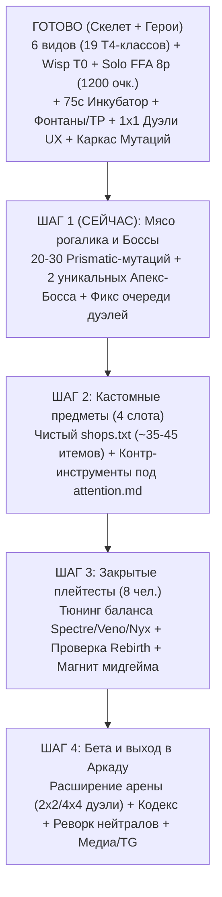

# Стратегическая аналитика проекта Evo («Adapt. Win.»)

> [!NOTE]
> **Обновлено 2026-11-26 (Ревизия v3 — Полная пересборка):** учтён огромный прогресс последнего спринта — **завершён полный релизный пул из 6 видов (19 финальных T4-архетипов, включая Spectre и Venomancer)**, переделан стартовый Wisp T0, полностью откалиброван **Solo FFA (8 игроков, цель `1200` очков)**, внедрён `3с` комбат-лок фонтана и медальон телепорта, вырезан `WorldEvent`, отполированы `60с` 1×1 дуэли с `5с` отсчётом/камерой/баннером/W-L, добавлен кастомный экран загрузки 16:9 & 21:9 и временное открытие тиров кемпов (`11:00 / 15:00 / 19:00`).

---

## 1. Честный срез проекта (Ревизия v3): Карта готовности

За один день проект прошёл путь от «перспективного скелета» до **полноценной играбельной Пре-Альфы с готовым пулом героев**.

### Оценка готовности по столпам игры

| Столп игры | Готовность | Что уже есть в коде | Что держит от 10/10 |
|---|---|---|---|
| **Пул героев и эволюций** | **9.5 / 10** | **6 полных видов = 19 финальных T4-классов** (Bristleback, Morphling, Slark, Nyx [4 ветки], Spectre, Venomancer) + быстрый фарм-кит стартового Wisp T0 (`evo_wisp_pulse`/`surge`). | Реальный плейтест-баланс перекосов из [attention.md](file:///c:/Program%20Files%20(x86)/Steam/steamapps/common/dota%202%20beta/game/dota_addons/evo/morph_data/attention.md) (теперь в коде живы и 100% рефлект Спектры, и 6 турелей Венома). |
| **FFA-ядро, UI и Game Feel** | **8.5 / 10** | Solo FFA (8p), динамический скор (`1200/1800/2500`), Инкубатор `75с`, `350` стартового золота + `90` GPM, Scan (`60с` КД / `3` заряда), фонтаны с `3с` комбат-локом + медальон TP, `5с` отсчёт дуэли + звук + камера + баннер + экран загрузки. | Нюанс очереди `4 × 60с` дуэлей в фулл-лобби (см. ниже) и вопрос уязвимости при `Rebirth → Lv.1`. |
| **Точки столкновений (PvP-ритм карты)** | **6.0 / 10** | Активные руны (`90с`, каждые `120с`), 1×1 дуэли (`180с`), 3-зарядный Scan, бродячий босс (`75с`). | После удаления `WorldEventManager` + отложенного спавна `medium/hard` кемпов до `11:00–15:00` окно `2:00–11:00` может стать слишком «лесными прятками» без магнита драк. |
| **Рогалик-реиграбельность (Мутации)** | **3.5 / 10** | Полностью рабочий пайплайн драфта (`T2/T3/T4`, 3 выбора, 2 реролла, UI, баффы, локализация). | **Главное узкое горлышко №1:** внутри всё ещё **10 микро-стат заглушек** (`+1` стат, `+5` урона). Нужны 20–30 Prismatic/Апекс-мутаций + связь с биомами/`diet`. |
| **Апекс-Боссы** | **4.0 / 10** | Отличный ИИ (фарм, закупка билдов, зелья, руны, уход от фонтанов). | **Узкое горлышко №2:** визуально один «обычный Слардар», а Босс-арена в Solo FFA отключена. Нужен редизайн 1-го + 2-й уникальный монстр-босс + FFA-мотивация охоты. |
| **Экономика и Предметы** | **3.5 / 10** | Заложена концепция `4` активных слотов + `DamageFilterManager`. | **Узкое горлышко №3:** в `shops.txt` пока ванильный набор Доты — ждёт переноса твоих кастомных предметов. |

> [!IMPORTANT]
> **Главный вывод v3:** Тебе **больше НЕ нужно делать новых героев до выхода на живые тесты!** 6 видов / 19 финальных классов — это уже больше, чем было на старте у *Dota 1x6*. Сейчас **100% фокуса** должны уйти в 3 вещи: **Prismatic-мутации → 2 уникальных Апекс-Босса → Кастомные предметы (4 слота)**.

---

## 2. Новые критические наблюдения (находки аудита v3)

После свежего спринта вскрылись **4 тонких геймдизайнерских момента**, которые важно увидеть до тестов в полном лобби на 8 человек:

### 1. Математика очереди дуэлей: `4 пары × 60с = 240с` при интервале `180с`
* **Где:** [game_constants.ts](file:///c:/Program%20Files%20(x86)/Steam/steamapps/common/dota%202%20beta/game/dota_addons/evo/src/vscripts/data/game_constants.ts#L148-L150), [DuelManager.ts](file:///c:/Program%20Files%20(x86)/Steam/steamapps/common/dota%202%20beta/game/dota_addons/evo/src/vscripts/systems/DuelManager.ts#L353-L371).
* **Проблема:** `DUEL_DURATION_SECONDS` увеличен до `60с`. В полном лобби на 8 человек `generateDuelPairs` ставит **4 пары последовательно**. Если бои идут по 45–60 секунд (а с танками типа Скарабея/Бастиона/Дредноута — точно будут!), то один раунд дуэлей растянется на **3–4 минуты**, перекрыв следующий интервал `180с`. Плюс 4-я пара будет ждать очереди 2.5 минуты, пока 1-я уже вернулась фармить.
* **Решение:**
  * *Быстрый фикс на Альфу:* либо ограничить цикл до **1–2 пар за раунд** (чередуя игроков по кругу / по заявкам, чтобы все дрались поровну), либо снизить таймер 1×1 до `40–45с` (или добавить «сужение огня / ускорение урона» на последних 15 секундах дуэли, как в *LoL Arena*).
  * *Идеальный фикс в Бете (из твоего бэклога!):* **массовые временные командные дуэли `2×2` / `4×4`** на расширенной арене — все 8 игроков дерутся **одновременно**, 0 очередей!

### 2. Вакуум столкновений в мидгейме (`2:00–11:00`) после удаления `WorldEvent`
* **Проблема:** Ты убрал KOTH-Метеорит (`WorldEventManager`), а `medium`/`hard` кемпы открываются только в `11:00` и `15:00`. Значит, первые ~10 минут в Solo FFA игроки могут безопасно сидеть на `small`-кемпах в разных углах, почти не пересекаясь (кроме 1×1 дуэлей и редких рун).
* **Лёгкие решения БЕЗ громоздкого KOTH-захвата:**
  * **«Охота за головой лидера» (Bounty Leader):** начиная с 4-й минуты игрок на 1-м месте по очкам (если отрыв `>150`) периодически подсвечивается на миникарте и даёт повышенную награду за голову — идеальный анти-сноуболл и естественный магнит для PvP!
  * **«Охота на Апекс-Босса»:** раз Босс-арена отключена в Solo FFA, пусть бродячий Апекс-Босс даёт настолько вкусный дроп (например, **Ядро/Реликвию** или **бонусную Мутацию / реролл**), чтобы 3–4 игрока сами сбегались в драку вокруг босса!
  * **Быстрые «Сгустки Биомассы / Сундуки» (как в Overthrow):** не 45-секундный захват точки, а 1 мгновенный подбор/сундук в центре раз в 2–3 минуты с 10-секундным предупреждением.

### 3. Балансная бомба в 1×1 дуэлях после выхода Spectre и Venomancer
* Теперь в игре реально доступны ветки из «красной зоны» [attention.md](file:///c:/Program%20Files%20(x86)/Steam/steamapps/common/dota%202%20beta/game/dota_addons/evo/morph_data/attention.md):
  * **Spectre «Зеркало Инверсии»:** `100%` отражение физ. урона в магию — в 1×1 дуэли против AGI-керри (Slark Охотник, Nyx Богомол, Venom Иглострел) это почти авто-победа без контр-предметов.
  * **Venomancer «Архитектор Улья»:** до `6` турелей (`300–500` DPS) — на маленькой 1×1 арене без места для кайта может сносить любого за секунды; при этом **«Споровый Симбионт»** (саппорт-аура) в Solo 1×1 окажется аутсайдером (зато расцветёт во временных `2×2`/`4×4` дуэлях!).
  * **Bristle Костолом / Nyx Богомол:** перма-станлок `50–60%` времени боя.
* **Вывод:** критически важно заложить **контр-инструменты в твои будущие 4-слотовые кастомные предметы** (анти-контроль, анти-рефлект, анти-саммон/сплеш, гарпун/блинк) + базовый диминишинг станов в `DamageFilter` / модификаторах.

### 4. Разбор твоих 2 новых идей из бэклога (`tasks.md`)

| Новая идея | Вердикт | Плюсы и скрытые подводные камни |
|---|---|---|
| **Временные командные дуэли `2×2` / `3×3` / `4×4` в Solo FFA** | **🔥 10/10 (Маст-хэв!)** | **Гениальное решение сразу 3 проблем:** (1) убирает очередь `4×60с` — дерутся все сразу; (2) даёт смысл командным/саппорт-веткам (*Веном Симбионт*, *Спектра Бастион*, *Морф Вода*) внутри Solo FFA; (3) рождает весёлые социальные истории («затащили 2×2 вместе, а потом сразу режем друг друга на карте»). |
| **Динамические союзы прямо в матче FFA** | **⚖️ 7/10 (Круто, но нужна защита от тиминга)** | **Плюс:** живая дипломатия («объединимся против лидера!») и фан с друзьями. **Главная угроза:** стак из 2–3 друзей в Discord будет каждый матч бегать вместе и душить соло-игроков → отток одиночек. **Обязательные предохранители:** (1) лимит союза **строго 2 игрока**; (2) **авто-разрыв всех союзов** в эндгейме (например, при `>= 75%` очков у лидера — «Выживет только один!»); (3) запрет союза между игроками в топ-2/топ-3 по очкам (или выделение союзов в фановый/unranked-режим). |

---

## 3. Уроки рынка Dota 2 Arcade (2019–2026) и утверждённая стратегия

> В **октябре 2026 года** Valve очистила Аркаду от ~200–300к фейковых ботов. Витрина снова живая — выигрывают кастомки с **коротким входом (< 60с)**, **матчем 18–25 мин**, **глубокими рогалик-билдами** и **низким порогом старта лобби**.

| Эталон | Что Evo уже переняла | Что ещё предстоит забрать |
|---|---|---|
| **Dota 1x6** *(Xeno)* | Solo FFA (высокая личная агентность), компактный но глубокий пул (6 видов / 19 классов), быстрый темп. | Высокая вариативность билда внутри одного класса (через **Мутации** + **4-слотовые предметы**), рейтинг/сезоны, медиа-движок. |
| **LoL Arena** | Быстрые раунды, фокус на PvP-стычках и дуэлях. | **Prismatic/Апекс-мутации**, ломающие правила игры (конвертация ХП/маны, крит скиллов, откат КД с тычек, гигантизм) + сужающийся круг в затяжной дуэли. |
| **Overthrow 3.0** | Понятный старт, скор-гонка, короткая сессия. | Надёжный магнит для стычек между дуэлями (сундук/босс/баунти на лидера) — и строгий отказ от P2W. |
| **Angel Arena / Darwin's Island** | Эволюция тела T0→T4, живой бродячий ИИ-босс с закупкой и билдами. | 2–3 **уникальных монстра-босса** (не дефолтные герои Доты) с собственными реликвиями и влиянием биомов/`diet` на эволюцию. |

### Утверждённый курс: `70% Вектор A + 30% Вектор B` (+ Предметы как элемент C)
1. **70% Рогалик-Броулер (Вектор A):** `Вид (T1) × Ветка (T2) × 3 Апекс-Мутации (T2/T3/T4) × 4 Предмета`. Мутации переписывают правила, а 5 биомов + `diet` влияют на пул генов или пассивную адаптацию.
2. **30% Экосистема Апекс-Боссов (Вектор B):** Переработка Эласмира (уход от скучного Слардара) + **2-й полностью уникальный Апекс-Босс** с другим стилем ИИ и Ядром-реликвией.
3. **Тактические предметы (Вектор C):** Зачистка ванильного `shops.txt` до **~30–45 кастомных предметов** в 4–5 категориях (Сила/Танк, Ловкость/Темп, Интеллект/Каст, Универсал/Утилити, Реликвии Босса) строго под **`4` активных слота** — с контр-инструментами против контроля, рефлекта и кайтеров.

---

## 4. Обновлённый роадмап: путь к публичной Альфе и релизу

---

## 5. Монетизация: как заработать на Evo (опыт Xeno, правила Valve и план)

> [!WARNING]
> **Жёсткая реальность Valve TOS (после августа 2023):** лицензия Dota 2 Workshop формально **строго некоммерческая**. В августе 2023 года юристы Valve разослали *cease-and-desist* крупнейшим проектам (*Dota 1x6*, *Ability Arena*, *Overthrow 3*, *Custom Hero Clash*) с требованием убрать прямую продажу БП, подписок, валют и скинов внутри клиента Доты. **Красная линия:** никакого встроенного магазина с кнопкой «Купить», никаких ценников в Panorama UI и **0% Pay-to-Win** — иначе прилетят репорты и бан в Workshop.

### Как на практике зарабатывает Xeno (Dota 1x6)
Успех Xeno строится не на «магазине в кастомке», а на **связке «Личный медиа-бренд + Краудфандинг комьюнити + Сайт-хаб»**:
1. **Boosty (СНГ: МИР/СБП) + Patreon (Запад):** несколько тиров ежемесячной подписки (`~$2.5`, `~$4–6`, `~$13+`):
   * Закрытые девлоги, разборы баланса и планы разработки.
   * Роль и приватный чат в Discord.
   * **Доступ к закрытым плейтестам** новых героев и патчей до релиза.
   * Закрытые стримы разработки, приоритет в лобби с автором и участие в обсуждении новых концептов.
2. **Медиа-движок (YouTube + Twitch + Telegram):** обзоры новых героев, патчноуты, нарезки и стримы приносят **100% белые деньги** (рекламные интеграции, донаты на стримах, партнёрки) и одновременно бесплатно гонят свежий онлайн в кастомку.
3. **Собственный веб-хаб (`dota1x6.com`):** авторизация через Steam, рейтинг/статистика, новости и привязка аккаунта сообщества.

### 3 уровня заработка для Evo: от хобби до серьёзных денег

| Уровень | Механика заработка | Потенциал | Риск от Valve |
|---|---|---|---|
| **1. Белый (Хобби + Медиа)** | **Boosty + Patreon** (закрытые тесты новых видов/боссов, Discord-роль, голосования за следующие ветки/мутации, девлоги, Зал Славы на сайте) + **YouTube Shorts / Telegram / Twitch** (реклама и донаты) | **$200–$1 500 / мес** *(при онлайне 300–1 500)* | **Минимальный** (деньги идут за медиа и внеигровое комьюнити) |
| **2. Веб-экосистема (Серая зона)** | Сайт `evo-dota` со Steam-логином, **MMR-лидербордом**, историей матчей, Кодексом эволюций и **подпиской комьюнити** с *чисто косметическими / QoL-плюшками* (рамка профиля, кастомный эффект морфа, расширенная аналитика матчей — **без P2W и без ссылок на оплату внутри UI Доты**) | **$1 000–$5 000+ / мес** *(при стабильном топе Аркады)* | **Средний** (нужно не наглеть, не продавать скины Valve и не встраивать шоп в клиент) |
| **3. Standalone-игра в Steam (Кэшаут)** | Использование Dota 2 Arcade как **бесплатного инкубатора фанбазы** → перенос проверенной формулы Evo (*T0→T4 эволюция + Prismatic-мутации + Апекс-Боссы + 4 слота*) в отдельную инди-игру на Godot/Unity/Unreal со своими оригинальными монстрами (**путь Auto Chess, Legion TD 2, Ability Arena**) | **Десятки–сотни тыс. $** *(полностью твоё IP)* | **Нулевой** (100% легально и полностью твоё) |

> [!TIP]
> **Скрытый супер-козырь Evo для Уровня 3:** в отличие от *Dota 1x6* (которая намертво привязана к героям и скиллам Dota 2), концепция **Evo — это оригинальные мутирующие монстры, биомы и Апекс-Боссы**. Если режим выстрелит в Аркаде и соберёт 5–15 тыс. фанатов в Discord/TG, его **в разы проще отвязать от IP Valve и выпустить как самостоятельный хит в Steam**!

### Пошаговый мини-план подключения монетизации
1. **Сейчас (Альфа, 0–50 игроков) — сбор ядра:** завести **Telegram-канал + Discord** («Дневник разработки Evo») и публиковать короткие 30-секундные ролики морфов (из Wisp в Спектру-Зеркало, Венома-Архитектора, Скарабея, Цикаду — контента с 19 классами уже на 2 месяца постов!).
2. **Первые 100–300 живых игроков — запуск Boosty + Patreon:** 3 честных тира (поддержка хобби / доступ к ранним тестам новых видов и мутаций / право голоса в выборе следующей ветки и имя в титрах). В описании Workshop — только ссылки на Discord/Telegram.
3. **Выход в топ Аркады (500–2 000+ онлайн) — медиа и веб-хаб:** запуск сайта с рейтингом/Кодексом, регулярные ролики под каждый патч (1 новый вид раз в 3–4 недели = всплеск онлайна + рекламные интеграции в TG/YouTube).
4. **Стабильный топ — решение о Standalone:** если комьюнити живое и платящее, начать параллельный прототип самостоятельной Steam-версии Evo с переносом всей аудитории.
